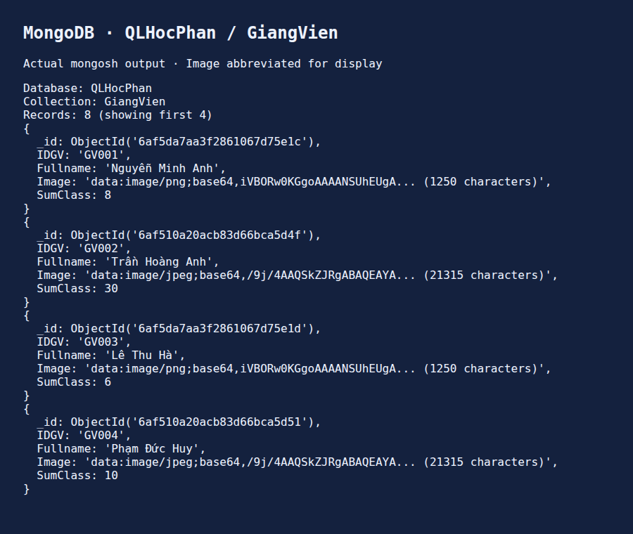
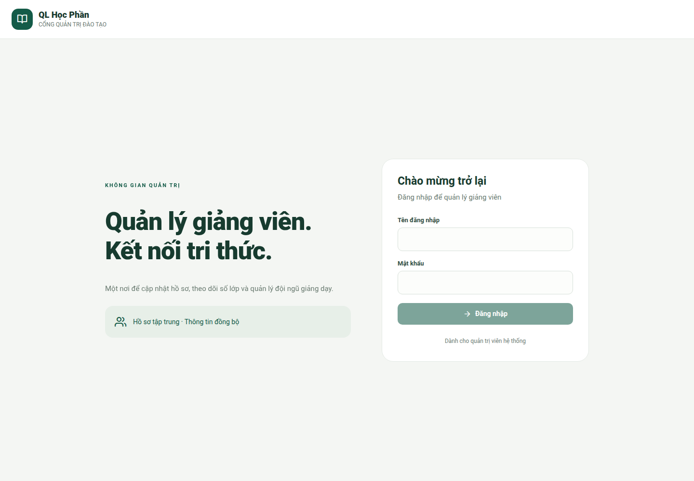
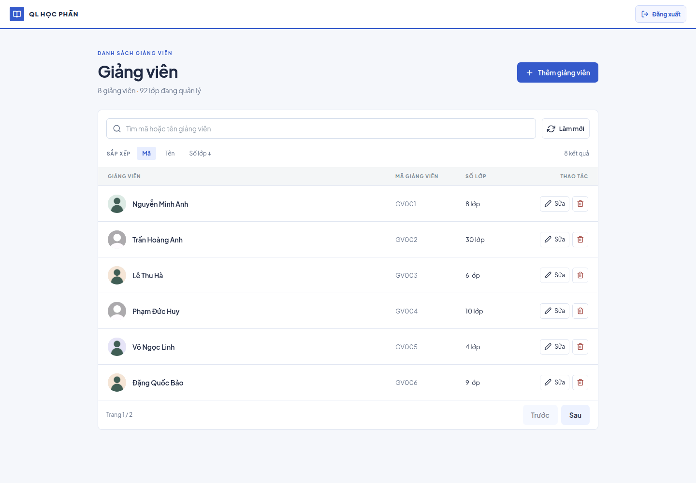
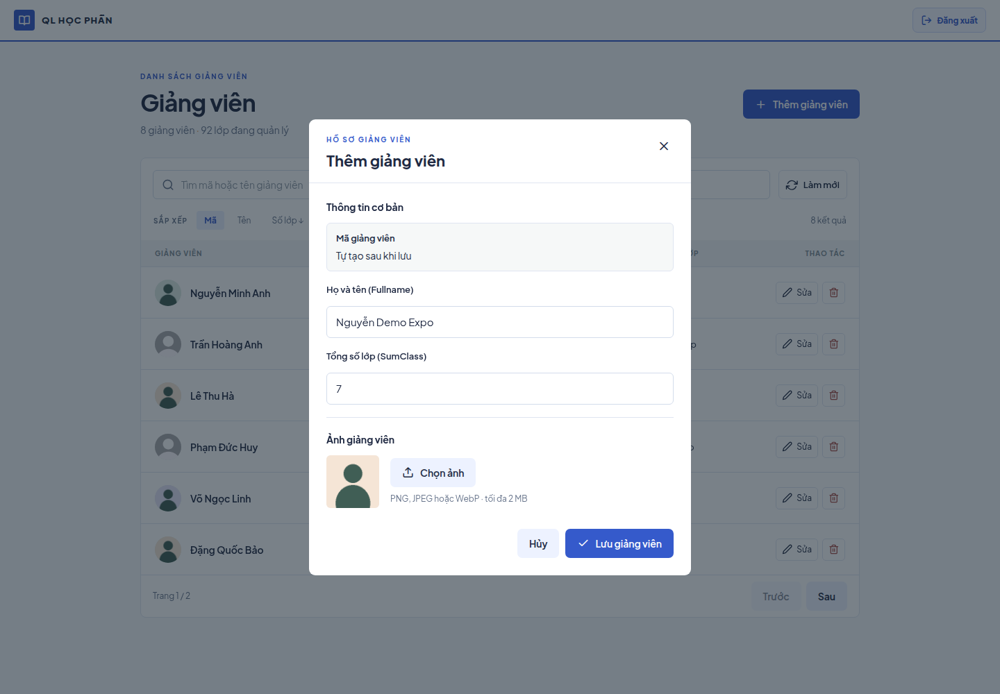
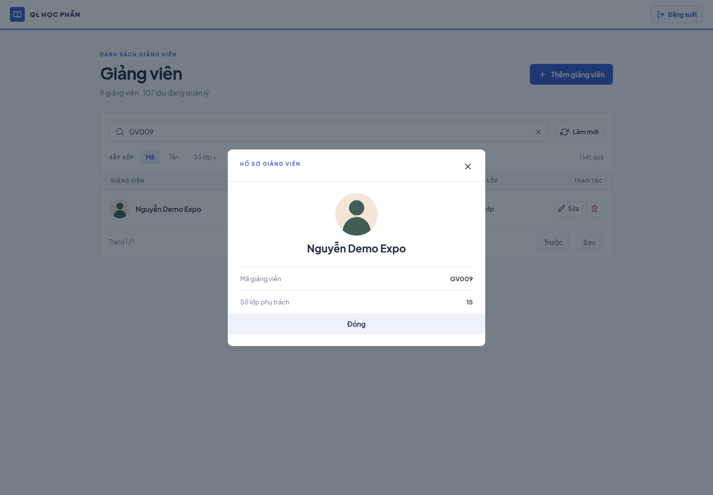
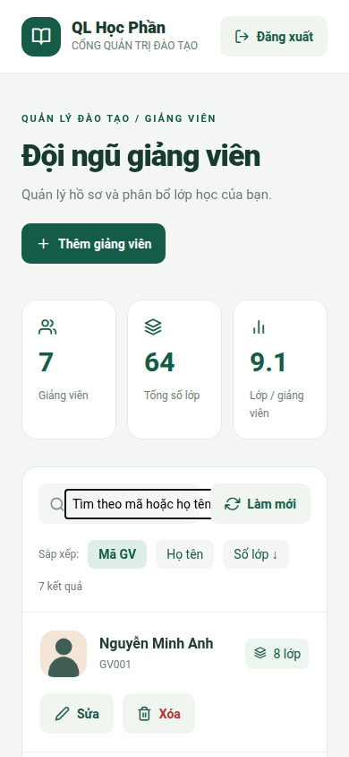
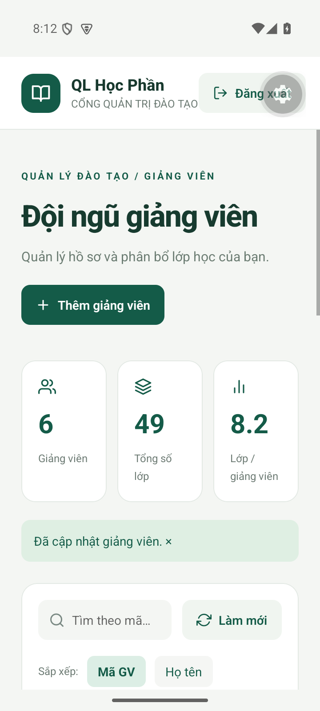
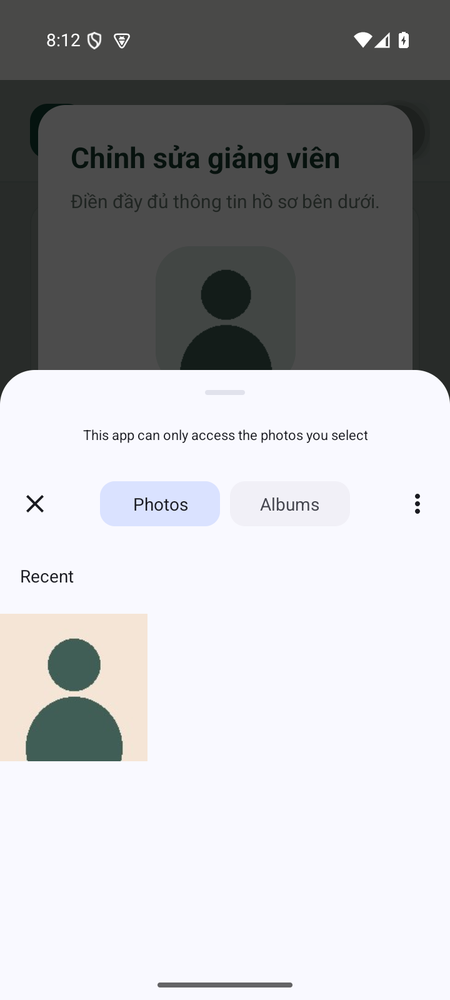
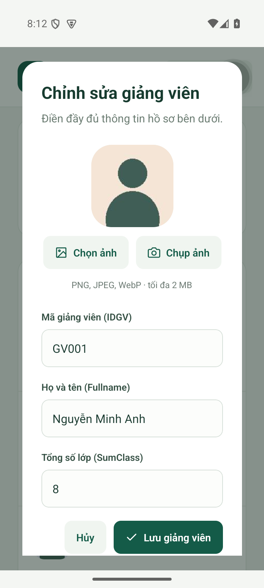

# BÁO CÁO GIỮA KỲ

- **Môn học:** Lập trình đa nền tảng
- **Đề tài:** Ứng dụng quản lý giảng viên QLHocPhan
- **Sinh viên:** Trần Văn Phước
- **MSSV:** 23IT217
- **Mã nguồn:** https://github.com/Phuocws0/ltdnt-gk-qlhocphan
- **Video web:** https://github.com/Phuocws0/ltdnt-gk-qlhocphan/blob/main/docs/videos/demo-web.webm
- **Video Android:** https://github.com/Phuocws0/ltdnt-gk-qlhocphan/blob/main/docs/videos/demo-android.mp4

Ứng dụng dùng React Native và Expo để chạy trên web, Android và iOS; Express cung cấp API; MongoDB lưu dữ liệu giảng viên. Báo cáo trình bày từng bước xây dựng, các đoạn mã chính và ảnh kiểm chứng kết quả.

<!-- pagebreak -->

## Bước 1 Tạo cấu trúc dự án

Dự án gồm ứng dụng Expo, backend Express, dữ liệu mẫu và thư mục minh chứng. Thiết bị gọi API qua HTTP trong môi trường demo, không kết nối trực tiếp với MongoDB.

```text
mobile/src/app/index.tsx       Giao diện và thao tác giảng viên
mobile/src/lib/api.ts          Gọi API và lưu phiên đăng nhập
server/src/app.js              REST API, xác thực và validation
server/src/db.js               Kết nối và ràng buộc MongoDB
database/GiangVien-export.json File dữ liệu nộp bài
docs/screenshots/              Ảnh minh chứng
```

## Bước 2 Cài đặt thư viện và khởi động

Các thư viện Expo được cài theo phiên bản SDK tương thích. Package lock giúp cài lại đúng phiên bản đã kiểm thử.

```bash
npm ci
npm ci --prefix server
npm ci --prefix mobile
cd mobile
npx expo install expo-image-picker expo-secure-store expo-font
npx expo install @expo-google-fonts/plus-jakarta-sans
```

Khởi động MongoDB bằng Docker, tạo cấu hình server, nạp dữ liệu mẫu rồi chạy web và backend:

```bash
npm run setup
docker compose up -d
npm run seed
npm run dev
```

## Bước 3 Tạo cơ sở dữ liệu MongoDB

Database có tên QLHocPhan, collection GiangVien. Mỗi hồ sơ chỉ có bốn trường nghiệp vụ IDGV, Fullname, Image, SumClass. MongoDB tự tạo _id; file JSON nộp bài đã loại trường kỹ thuật này. Schema cấm thêm trường ngoài danh sách.

```javascript
required: ["IDGV", "Fullname", "Image", "SumClass"],
additionalProperties: false,
properties: {
  _id: { bsonType: "objectId" },
  IDGV: { bsonType: "string" },
  Fullname: { bsonType: "string" },
  Image: { bsonType: "string" },
  SumClass: { bsonType: ["int", "long", "double", "decimal"] },
}
```

Ảnh dưới đây lấy từ mongosh. Chuỗi ảnh Base64 được rút ngắn để dễ đọc; file JSON vẫn chứa ảnh đầy đủ. Bản xuất hiện tại có 8 hồ sơ.



## Bước 4 Kết nối backend với MongoDB

Backend đọc địa chỉ MongoDB từ biến môi trường, áp dụng validator và tạo unique index cho IDGV. Mật khẩu database không nằm trong ứng dụng Expo.

```javascript
export const client = new MongoClient(
  process.env.MONGODB_URI || "mongodb://127.0.0.1:27028",
);
export async function connect() {
  await client.connect();
  const db = client.db(process.env.MONGODB_DB || "QLHocPhan");
  const collection = db.collection("GiangVien");
  await collection.createIndex({ IDGV: 1 }, { unique: true });
  return collection;
}
```

## Bước 5 Lập trình đăng nhập quản trị

Server so sánh mật khẩu với bản băm bcrypt trong cấu hình. Khi thông tin đúng, server cấp JWT có thời hạn 8 giờ. Sai tài khoản hoặc mật khẩu trả HTTP 401; API giới hạn số lần thử đăng nhập.

```javascript
const valid = await bcrypt.compare(password, config.passwordHash);
if (username !== config.username || !valid)
  return res.status(401).json({
    message: "Tên đăng nhập hoặc mật khẩu không đúng.",
  });
res.json({
  token: jwt.sign({ role: "admin" }, config.secret, {
    subject: username,
    expiresIn: "8h",
  }),
  username,
});
```

## Bước 6 Bảo vệ API bằng JWT

Các endpoint giảng viên kiểm tra Bearer token trước khi truy cập MongoDB. Ứng dụng lưu phiên bằng SecureStore trên Android/iOS và sessionStorage trên web. Nút Đăng xuất xóa token cục bộ.

```javascript
app.use("/api", (req, res, next) => {
  try {
    const token = req.headers.authorization?.replace(/^Bearer /, "");
    const claims = jwt.verify(token, config.secret);
    if (claims.role !== "admin") throw Error();
    next();
  } catch {
    res.status(401).json({
      message: "Phiên đăng nhập đã hết hạn. Vui lòng đăng nhập lại.",
    });
  }
});
```

## Bước 7 Hiển thị danh sách giảng viên

GET /api/giang-vien đọc dữ liệu từ MongoDB và trả các trường nghiệp vụ, bỏ _id. Giao diện có tìm kiếm theo mã hoặc tên, sắp xếp theo mã, tên hoặc số lớp và phân trang sáu hồ sơ mỗi trang.

```javascript
res.json(
  await collection
    .find(filter, { projection: { _id: 0 } })
    .sort({ [sort]: req.query.order === "desc" ? -1 : 1, IDGV: 1 })
    .toArray(),
);
```

## Bước 8 Thêm giảng viên và tự tạo mã

Người dùng nhập họ tên, số lớp và chọn ảnh. Server cấp mã dạng GV001, GV002 theo mã lớn nhất hiện có; unique index và thao tác thử lại xử lý hai yêu cầu tạo cùng lúc. Client không gửi IDGV thủ công.

```javascript
async function nextTeacherId(collection) {
  const existing = await collection
    .find({ IDGV: /^GV\d+$/ }, { projection: { IDGV: 1, _id: 0 } })
    .toArray();
  const max = existing.reduce(
    (value, row) => Math.max(value, Number(row.IDGV.slice(2))), 0
  );
  return `GV${String(max + 1).padStart(3, "0")}`;
}
```

Server chỉ chấp nhận ảnh PNG, JPEG hoặc WebP hợp lệ, tối đa 2 MB. Họ tên dài 2–100 ký tự; số lớp là số nguyên từ 0 đến 999. Lỗi nhập liệu trả HTTP 400.

## Bước 9 Sửa và xóa giảng viên

PUT /api/giang-vien/:id cập nhật họ tên, ảnh, số lớp nhưng giữ nguyên mã tự sinh. DELETE /api/giang-vien/:id chạy sau hộp xác nhận trên giao diện. Hồ sơ không tồn tại trả HTTP 404.

```javascript
const input = teacherInput.parse(req.body);
const r = await collection.updateOne(
  { IDGV: req.params.id }, { $set: input }
);
if (!r.matchedCount)
  return res.status(404).json({ message: "Giảng viên không tồn tại." });
```

```javascript
const r = await collection.deleteOne({ IDGV: req.params.id });
if (!r.deletedCount)
  return res.status(404).json({ message: "Giảng viên không tồn tại." });
res.status(204).end();
```

<!-- pagebreak -->

## Bước 10 Nhập và hiển thị ảnh trên di động

Expo ImagePicker mở thư viện ảnh hoặc camera. Người dùng có thể cắt ảnh vuông, xem trước rồi lưu ảnh Base64 vào trường Image. Ảnh hiển thị ở danh sách và màn hình chi tiết trên web và Android; iOS dùng cùng mã React Native.

```typescript
const result = await (
  camera
    ? ImagePicker.launchCameraAsync
    : ImagePicker.launchImageLibraryAsync
)({
  mediaTypes: ["images"],
  base64: true,
  quality: 0.7,
  allowsEditing: true,
  aspect: [1, 1],
});
```

## Bước 11 Gửi biểu mẫu từ Expo

Ứng dụng kiểm tra dữ liệu trước khi gửi. Khi thêm dùng POST, khi sửa dùng PUT. Sau khi lưu thành công, danh sách được tải lại từ MongoDB. Giao diện dùng font Plus Jakarta Sans và có nút Đăng xuất trên thanh trên.

```typescript
await request(
  "/giang-vien" + (editing ? "/" + encodeURIComponent(editing) : ""),
  token,
  editing ? "PUT" : "POST",
  {
    Fullname: form.Fullname,
    Image: form.Image,
    SumClass: Number(form.SumClass),
  },
);
await load();
```

## Bước 12 Kiểm thử và xuất dữ liệu nộp bài

API integration test chạy với MongoDB thật trong database test riêng, kiểm tra xác thực, CRUD, validation và mã tự sinh khi tạo đồng thời. Playwright kiểm tra web: đăng nhập, thêm ảnh, sửa, tìm kiếm, xem chi tiết, xóa và đăng xuất. TypeScript, ESLint và export Expo cho web, Android, iOS đều đạt. Android native đã được kiểm tra trên Expo Go; iOS chưa chạy trực tiếp trên thiết bị.

```bash
npm --prefix server test
npx playwright test
npm --prefix mobile run typecheck
npm --prefix mobile run lint
cd mobile && npx expo export --platform all
npm run export
```

<!-- pagebreak -->

## Kết quả trên nền tảng web

### Màn hình đăng nhập

Người dùng nhập tài khoản quản trị để xem danh sách giảng viên.



### Danh sách giảng viên

Danh sách hiển thị ảnh, mã, họ tên, số lớp, công cụ tìm kiếm, sắp xếp và nút Đăng xuất.



### Thêm giảng viên và chọn ảnh

Mã giảng viên được tự động tạo sau khi lưu. Biểu mẫu cho xem trước ảnh đã chọn.



### Chi tiết giảng viên

Sau khi sửa, hồ sơ hiển thị số lớp mới và ảnh trong màn hình chi tiết.



### Giao diện web trên màn hình nhỏ

Bố cục danh sách chuyển sang dạng gọn khi chiều rộng tương đương điện thoại.



## Kết quả trên Android

### Danh sách trên ứng dụng Expo

Ứng dụng React Native chạy trong Expo Go trên trình giả lập Android API 35.



### Chọn ảnh từ thư viện Android

Expo ImagePicker mở trình chọn ảnh của hệ điều hành.



### Ảnh sau khi chọn và lưu

Ảnh được đọc, lưu vào trường Image và hiển thị trong ứng dụng.



## Tệp và liên kết bàn giao

- Mã nguồn: https://github.com/Phuocws0/ltdnt-gk-qlhocphan
- Báo cáo PDF: output/pdf/Bao-cao-QLHocPhan.pdf
- File MongoDB JSON: database/GiangVien-export.json
- Video demo web: https://github.com/Phuocws0/ltdnt-gk-qlhocphan/blob/main/docs/videos/demo-web.webm
- Video demo Android: https://github.com/Phuocws0/ltdnt-gk-qlhocphan/blob/main/docs/videos/demo-android.mp4

File JSON gồm đúng bốn trường IDGV, Fullname, Image, SumClass. Video trong repo có thể được thay bằng bản quay cuối cùng của sinh viên trước khi nộp.
